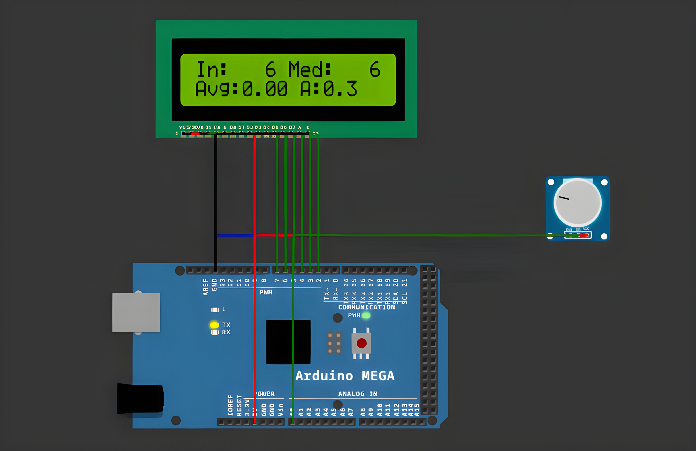

# FreeRTOS Signal Conditioning System

<table align="center">
  <tr>
    <td align="center">
      
    </td>
  </tr>
</table>

## Overview

FreeRTOS Signal Conditioning System is an embedded application for Arduino Mega that acquires an
analog signal from a potentiometer, cleans it with two digital filters, converts it into a physical
parameter (angle 0–270°) and reports the raw and filtered values over STDIO (Serial) and on a
16x2 LCD. Periodic execution is handled by three FreeRTOS tasks using `vTaskDelayUntil()` and
start offsets.

## Features

- **Periodic Acquisition**: Reads the potentiometer on `A0` at 50 Hz (every 20 ms) and passes the
  raw ADC value to the processing task through a 1-element overwrite queue.
- **Salt & Pepper Filter**: A 5-sample median filter removes isolated impulsive outliers.
- **Weighted Average Filter**: A 4-sample weighted average (weights 50/25/15/10) smooths the signal
  while keeping a fast response to real changes.
- **Conversions**: ADC → voltage (0..5000 mV), then voltage → physical parameter (angle 0..270°).
- **Saturation**: Voltage and angle are clamped to their valid ranges (0–5 V and 0–270°).
- **Periodic Report**: Every 500 ms, raw and filtered values are printed with `printf` and shown
  on the LCD.
- **Fixed-Point Printing**: Values are printed in mV and split into integer/fraction parts, since
  `printf("%f")` is not supported by default on AVR.
- **Clean Architecture**: Layered structure (APP / SRV / ECAL / LIB) with the sensor driver, filter
  library, STDIO service and application logic in separate modules.

## Technologies

- **Platform**: Arduino Mega 2560
- **Language**: C++ (Arduino Framework)
- **RTOS**: FreeRTOS
- **Libraries**: LiquidCrystal
- **Build System**: PlatformIO
- **Simulation**: Wokwi
- **Development Tools**: Visual Studio Code + PlatformIO IDE
- **Version Control**: Git, GitHub

## Processing Pipeline

```
Potentiometer → ADC → Median(5) → Weighted Avg(4) → Saturation → Voltage → Angle → STDIO / LCD
```

## FreeRTOS Tasks

| Task | Period | Start Offset | Role |
|---|---|---|---|
| `taskAcquire` | 20 ms (50 Hz) | 0 ms | Reads the ADC and sends the raw value to the queue |
| `taskProcess` | 20 ms (50 Hz) | 5 ms | Filters, converts and saturates the signal |
| `taskReport` | 500 ms (2 Hz) | 15 ms | Prints the report on Serial and updates the LCD |

## Project Structure

```
src/
├── app/
│   ├── application.cpp
│   └── application.h
├── ed_potentiometer/
│   ├── ed_potentiometer.cpp
│   └── ed_potentiometer.h
├── lib_cond/
│   ├── lib_cond.cpp
│   └── lib_cond.h
├── srv_stdio_serial/
│   ├── srv_stdio_serial.cpp
│   └── srv_stdio_serial.h
└── main.cpp
diagram.json
wokwi.toml
platformio.ini
```

## Pin Mapping

| Component | Pin | Action |
|---|---|---|
| Potentiometer (SIG) | A0 | Analog input signal |
| Potentiometer (VCC) | 5V | Power supply |
| Potentiometer (GND) | GND | Ground |
| LCD RS | 7 | Register select |
| LCD E | 6 | Enable |
| LCD D4 – D7 | 5, 4, 3, 2 | 4-bit data lines |

## Resources

- [Wokwi Documentation](https://docs.wokwi.com/)
- [FreeRTOS Documentation](https://www.freertos.org)
- [AVR Libc STDIO](https://www.nongnu.org/avr-libc/user-manual/group__avr__stdio.html)
- [Arduino Reference](https://www.arduino.cc/reference/en/)
- [PlatformIO Documentation](https://docs.platformio.org)

## Installation

To build and run the application, follow these steps:

1. **Clone this repository:**
```bash
git clone https://github.com/Constantin-Stamate/signal-conditioning
```

2. **Navigate to the project directory:**
```bash
cd signal-conditioning
```

3. **Open the project in VS Code with the PlatformIO extension installed**

4. **Build and upload to the board (or run the Wokwi simulation):**
```bash
pio run --target upload
```

5. **Open the serial monitor and turn the potentiometer:**
```bash
pio device monitor -b 9600
```

```
Turn the potentiometer -> RAW and Vin follow the knob directly, while Vmed and Vavg
                          change more smoothly; the angle stays within 0..270 deg
```

## Contributors

**FreeRTOS Signal Conditioning System** was developed as part of the Internet of Things laboratory works.

- GitHub: [Constantin-Stamate](https://github.com/Constantin-Stamate)
- Email: constantinstamate.r@gmail.com